# VECTOR TANKS

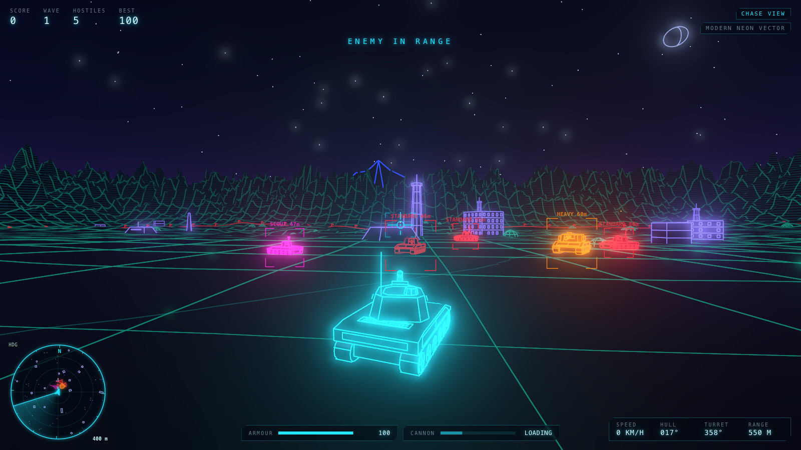

A browser-based 3D tank combat game inspired by the 1980 arcade classic *Battlezone* and the 1989 Acorn Archimedes game *3D Tanks*, rebuilt with modern hidden-line vector graphics, physics-based tank handling, state-machine enemy AI, a compact radar and a full tactical map.

Everything is original code and procedurally generated geometry and sound. There are no asset downloads, accounts or backend services: the game runs entirely in the browser.

- **Three graphics modes on one simulation:** Classic Vector (green phosphor), **Modern Neon Vector** (default, true hidden-line removal) and Hybrid 3D (shaded armour with shadows). Switching mode never resets the game.
- **Three cameras:** gunner (first person), chase (third person) and tactical (overhead).
- **Three enemy types:** standard, heavy and scout, each with distinct AI behaviour, across escalating waves.
- **Battlefields:** seeded procedural terrain with hills, flat combat basins, a boundary mountain range, rocks, futuristic structures and two- to four-storey buildings. Choose gentle rolling ground, or Hilly ground whose ridges and valleys give real cover.
- **Rivers, lakes and bridges:** rivers cross every battlefield with bridges along them, and lakes and ponds lie in the hollows. Tanks wade the shallows but can't cross deep water, and enemies plan their way over the bridges. Optional fords add shallow crossings.

## Screenshots

<table>
  <tr>
    <td width="50%">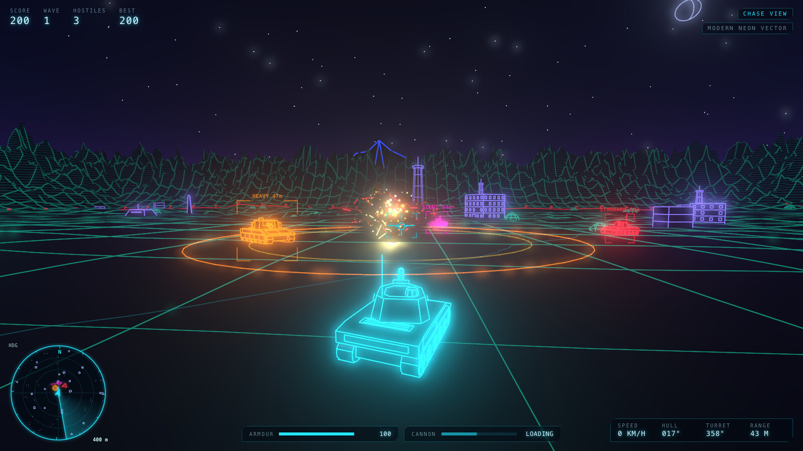</td>
    <td width="50%">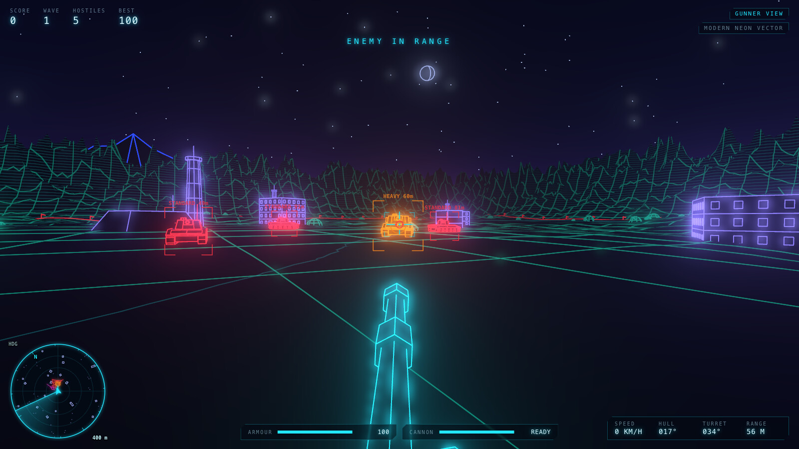</td>
  </tr>
  <tr>
    <td><b>Direct hit.</b> A destroyed tank throws out debris and a shockwave, and the kill feed scores it.</td>
    <td><b>Gunner view.</b> Target brackets mark enemies in line of sight. The gun marker turns red when the shot would hit.</td>
  </tr>
  <tr>
    <td>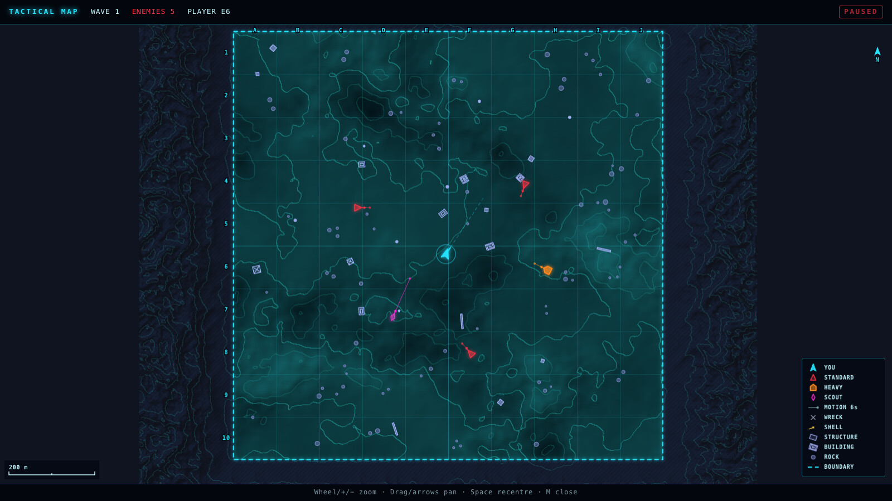</td>
    <td>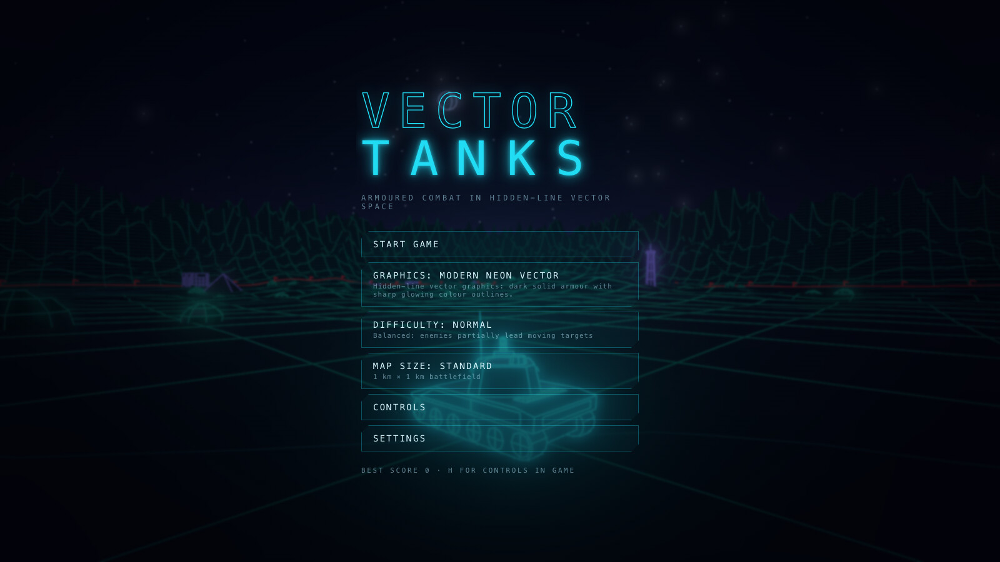</td>
  </tr>
  <tr>
    <td><b>Tactical map.</b> The whole battlefield with relief, contours, water, bridges and fords, grid references and live enemy motion vectors.</td>
    <td><b>Main menu.</b> Choose graphics mode, difficulty and map size over a live battlefield.</td>
  </tr>
  <tr>
    <td>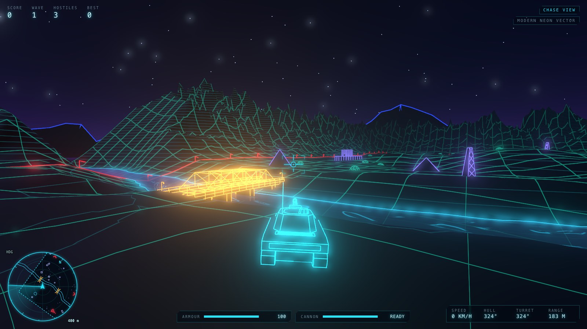</td>
    <td>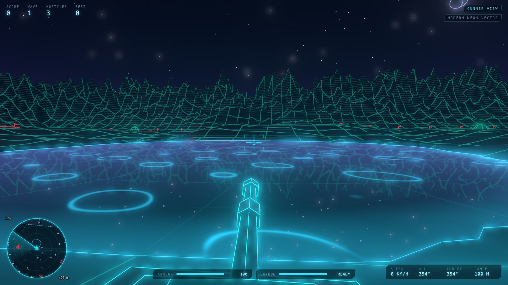</td>
  </tr>
  <tr>
    <td><b>Rivers and bridges.</b> The longest crossing on each river is a through truss; the others ride on plate girders.</td>
    <td><b>Lake reflections.</b> At High quality the nearest lake in view mirrors the scenery.</td>
  </tr>
  <tr>
    <td>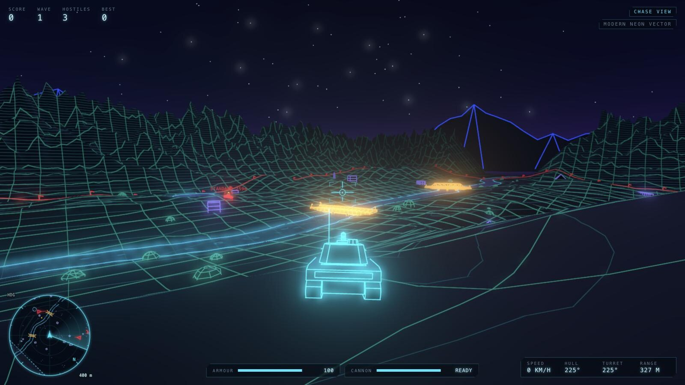</td>
    <td>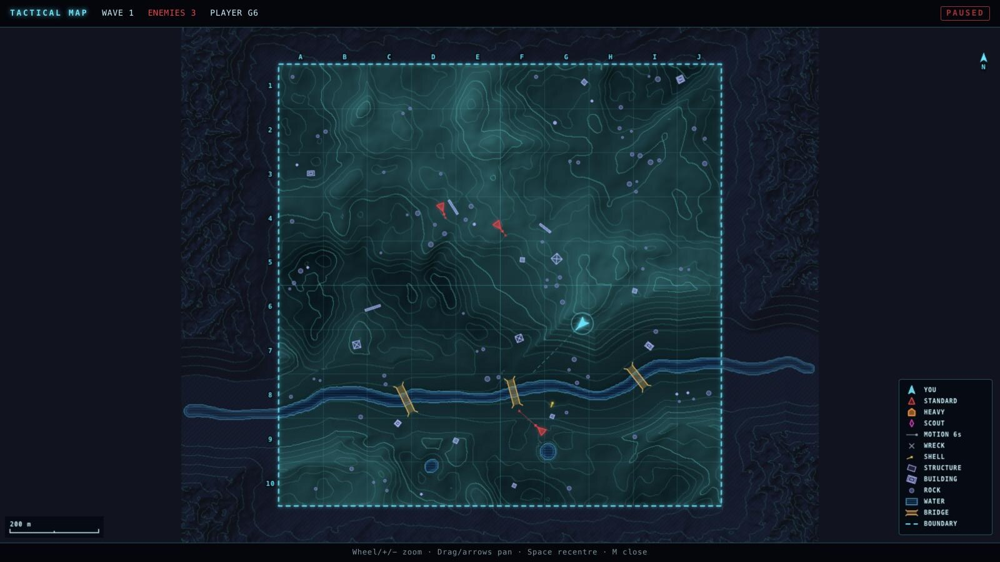</td>
  </tr>
  <tr>
    <td><b>Hilly terrain.</b> Ridges and valleys break line of sight, and rivers run through valley benches so their bridges still fit.</td>
    <td><b>Hilly tactical map.</b> Dense contours show the ridges and hollows to hide behind.</td>
  </tr>
</table>

---

## Prerequisites

- **Node.js 20.19+ or 22.12+** (developed with Node 24) and npm.
- A desktop browser with **WebGL 2**: current Chrome, Edge, Firefox or Safari.

## Installation and commands

```bash
npm install
```

```bash
npm run dev
```

Opens the dev server at <http://localhost:5173>.

| Command | What it does |
|---|---|
| `npm run dev` | Development server with hot reload |
| `npm run build` | Type-checks (`tsc --noEmit`) then builds a production bundle into `dist/` |
| `npm run preview` | Serves the production build locally |
| `npm run typecheck` | Strict TypeScript check only |
| `npm run lint` | ESLint (typescript-eslint `strictTypeChecked`) |
| `npm test` | Runs the Vitest suite once |
| `npm run test:watch` | Vitest in watch mode |
| `npm run coverage` | Tests with a V8 coverage report |

The production build is a static site in `dist/`; serve it from any static web host. Asset paths are relative, so a subfolder works too.

**Battlefield seeds:** each new game uses a random battlefield. To replay a specific one, add a seed to the URL, for example `http://localhost:5173/?seed=12345`. **Restart** after game over always reuses the same battlefield. The seed is shown when a game starts and on the game-over screen. Turning fords on (see [Water and bridges](#water-and-bridges)) changes the battlefield a seed gives.

---

## Controls

| Input | Action |
|---|---|
| **W / S** or **↑ / ↓** | Throttle ahead / reverse |
| **A / D** or **← / →** | Turn the hull left / right |
| **Mouse** | Aim turret and gun (the turret traverses at a finite rate) |
| **Left mouse** or **Space** | Fire the cannon (hold to fire as soon as it reloads) |
| **Right mouse** (hold) | Zoom the sight (gunner and chase views) |
| **Mouse wheel** | Chase-camera distance / tactical-view altitude |
| **V** | Cycle camera: gunner → chase → tactical |
| **M** | Open / close the tactical map |
| **R** | Toggle the compact radar |
| **C** | Cycle graphics mode: Classic → Neon → Hybrid |
| **F** | Toggle fullscreen |
| **H** | Show / hide the in-game controls help |
| **Esc** | Pause and open the menu (also closes the map / help) |
| **Enter** | Restart after game over |
| **P** or **`** | Toggle the performance overlay |

**On the tactical map:**
- Mouse wheel (or + / −) zooms at the cursor.
- Drag, arrow keys or WASD pan the map.
- Space re-centres on the player, and M or Esc closes the map.
- The tank never drives or fires while the map is open.

**Gamepad (standard layout):**
- Left stick drives and the right stick aims.
- RT (or A) fires and LT zooms.
- Y cycles cameras, X toggles the radar, View/Back opens the map and Start pauses.

**Mouse capture:** clicking the battlefield captures the mouse with Pointer Lock. Esc releases it and pauses the game. If the browser refuses Pointer Lock (some embedded browsers do), the game keeps working: mouse movement still aims and clicks fire.

Mouse sensitivity, invert-Y and field of view are in **Settings**.

---

## Gameplay

**Goal:** you command a single tank and fight escalating waves of enemy armour. The game ends when your tank is destroyed.

**Waves:**
- Each wave announces itself, then enemies spawn at least 240–280 m away. Only a limited number are on the field at once.
- Waves grow by two tanks each time. Heavy tanks join from wave 2 and scouts from wave 3.
- Enemies get more accurate as waves progress.
- Clearing a wave gives a score bonus and repairs some of your armour.

**Damage:**
- Shells are visible projectiles with real travel time and gravity.
- Hits on an enemy's rear do 130% damage, side hits 100% and frontal hits 80%. Heavy tanks also have 25% armour.

**Score:** destroying tanks scores points. Kills are worth more in later waves and on harder difficulties.

**Statistics:** the game tracks score, kills by type, wave reached, survival time, shots fired, hits and accuracy. Your best score is saved in browser storage.

### Aiming

The crosshair marks where you want to hit. The game casts a ray from the active camera, finds the terrain, obstacle or tank under the crosshair, and lays the gun with a ballistic solution from the real muzzle. Camera-to-muzzle offset (important in the chase view) and shell drop are therefore both compensated.

The small **gun marker** circle shows where the barrel is *actually* pointing right now. It lags while the turret traverses, and turns red when the current trajectory would hit an enemy. The HUD readout panel shows range, speed, hull heading and turret heading.

### Enemies

| Type | Speed | Armour | Behaviour |
|---|---|---|---|
| **Standard** (red) | Medium | Medium | Patrols, investigates gunfire, pursues, circles at ~150 m while firing, sometimes swerves when hit, retreats when badly damaged |
| **Heavy** (orange) | Slow | Very high, plus frontal armour | Advances steadily, keeps its thick front towards you, slow turret but hard-hitting gun, never retreats |
| **Scout** (magenta) | Fast | Light | Small and hard to hit; flanks around your sides, evades when hit, retreats and repositions |

The AI is a maintainable state machine with these states:
- Idle, Patrol, Investigate, Pursue, Attack, Flank, Evade, Retreat and Destroyed.

Perception:
- Enemies need line of sight within a detection range, and react after a randomised delay.
- They hear nearby tanks and gunfire.
- They never fire through terrain, buildings or their own side.

Steering:
- Enemies use the same throttle and turn controls and tank physics as the player.
- They avoid obstacles, other tanks, steep ground and the boundary, and recover automatically when stuck.

Accuracy:
- Every shot has Gaussian aim error.
- On Normal they partially lead moving targets; on Hard they fully compensate for shell travel time.

### Difficulty

| | Easy | Normal | Hard |
|---|---|---|---|
| Detection range | 230 m | 300 m | 380 m |
| Reaction time | 1.0–1.8 s | 0.55–1.1 s | 0.25–0.6 s |
| Target leading | none | partial | full |
| Simultaneous enemies | 3+ | 4+ | 6+ |
| Damage to you | ×0.6 | ×1 | ×1.25 |
| Score multiplier | ×0.75 | ×1 | ×1.5 |

### Map size

Choose the battlefield size on the main menu. It is saved with your settings and applies to the next new game.

| | Standard | Large | Huge |
|---|---|---|---|
| Playable area | 1 × 1 km | 2 × 2 km | 3 × 3 km |
| Rocks and structures | up to 99 | up to 396 | up to 891 |
| Rivers | 1 | up to 2 | up to 3 |
| Lakes and ponds | up to 1 and 2 | up to 4 and 8 | up to 9 and 18 |

- Obstacle, lake and pond counts grow with the area, so cover and water are equally dense on every size. Rivers grow with the side length.
- Enemy waves still spawn 260–480 m from you, so fights start just as quickly. The extra space is for manoeuvring and flanking.
- Huge draws roughly four times as many triangles as Standard. If your GPU struggles, *Auto-reduce quality* (on by default) steps the quality down.
- A new battlefield is generated in a background thread (a Web Worker), so the menu stays responsive and shows *GENERATING BATTLEFIELD…* meanwhile. That takes about half a second on Huge. Building its 3D scene afterwards still holds the game for about 0.2 s.

### Terrain

Choose the ground in **Settings → Battlefield → Terrain (new battlefields)**. It is saved with your settings and applies to the next new battlefield.

| | Gentle (default) | Hilly |
|---|---|---|
| Height range of most of the ground | about 12 m | 36–43 m |
| Battlefield hidden from a tank at 60–150 m | 23–26% | 39–45% |
| Median move to cover from a tank 120 m away | 20–25 m | 5–10 m |
| Ground too steep for enemies | under 1% | about 6.5% |

- **Gentle** is the original rolling ground with flat combat basins. Every seed gives exactly the battlefield it always has.
- **Hilly** has taller hills, rounded ridgelines and fewer flat basins, so a short drive usually breaks line of sight. Climbs are longer and slower, and enemies steer around the steepest slopes.
- On Hilly ground each river runs through a valley with a gentle bench beside each bank, so its bridges and fords still fit.
- The spawn area stays level on both.
- Hilly changes the battlefield a seed gives, so the start banner shows HILLY and the game over screen lists the terrain.

### Water and bridges

- **Wading:** water up to 1.2 m deep slows a tank, to under half speed at its deepest. Wading throws spray, leaves a wake and sloshes. Deeper water stops a tank at its edge.
- **Bridges:** roads cross each river every 220–380 m, on bridges with earth ramps at both ends. The parapets keep you on the deck, so you drive on and off over the ends. Bridges cannot be destroyed.
- **Shells and sight:** a shell that hits the water throws up a splash. Water never blocks line of sight, so you can shoot, and be shot, across a river.
- **Enemies:** when water stands between an enemy and where it is going, it plans a route over the cheapest crossing. Enemies already on a bridge have right of way, so tanks never meet head-on on a deck.
- **Fords (optional):** **Settings → Battlefield → Shallow river fords** gives each river one shallow crossing about 0.6 m deep, away from its bridges. Marker posts with pennants stand on both banks, and the map and radar mark the ford with two dashed lines. Fords are off by default and apply to new battlefields, because they change the battlefield a seed gives. The start banner shows FORDS when they are on.

### HUD, radar and tactical map

**HUD:**
- Score, wave (with a countdown between waves), hostiles remaining and best score.
- Armour and cannon reload bars.
- Speed, hull heading, turret heading and range.
- Crosshair and gun marker.
- Brackets on enemies you can actually see.
- Incoming-fire arcs pointing at your attacker.
- Warning messages: *ENEMY IN RANGE* and *ENEMY TO LEFT / RIGHT / REAR*.
- A kill feed and wave banners.

**Compact radar:**
- Heading-up by default; north-up is available in Settings.
- Shows range rings and an animated sweep.
- Enemies are drawn with kind-specific colours and symbols plus a direction-of-travel line. Contacts beyond range appear as chevrons on the rim.
- Also shows nearby rocks and structures, shorelines, bridges and fords, shells and wrecks.

**Tactical map (M):**
- **What it shows:**
  - The whole battlefield with shaded relief and contour lines.
  - A–J / 1–10 grid references, a scale bar and a legend.
  - Every obstacle at its real footprint. Buildings show one tick per storey.
  - Water shaded by depth and hatched, with a line where it becomes too deep to cross. Bridges and fords are drawn with their map signs.
  - The player's heading and turret.
  - Every enemy with heading and a six-second motion vector, updated live.
  - Shells and wrecks.
- **Controls:** zoom and pan.
- **Pause:** the map pauses the game by default. Settings can make it real-time, or restrict it to radar-detected enemies (harder) with fading last-known positions.

---

## Graphics modes

All three modes render the same scene graph from the same simulation. A mode changes only colours, material styles, lighting and post-processing. Here is the same battle in each mode:

| Classic Vector | **Modern Neon Vector** (default) | Hybrid 3D |
|---|---|---|
| 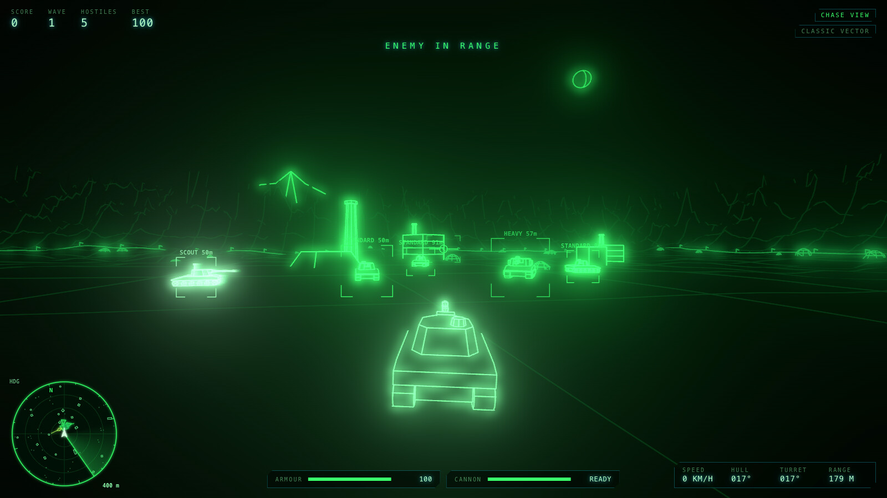 | 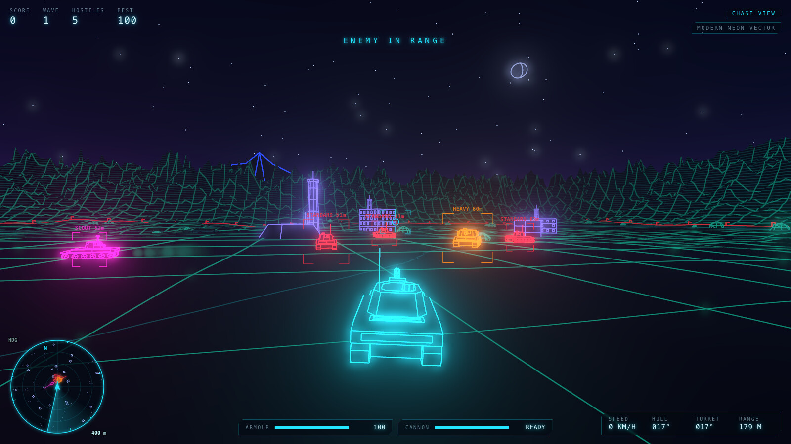 | 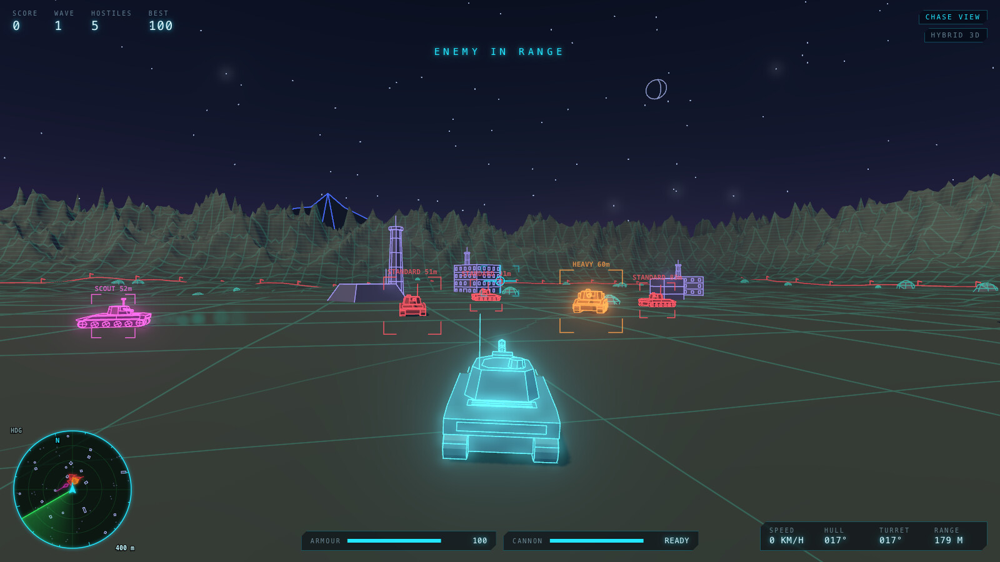 |

| | Classic Vector | **Modern Neon Vector** (default) | Hybrid 3D |
|---|---|---|---|
| Surfaces | Pure black occluders | Near-black, subtly lit, glossy armour | Shaded, coloured armour |
| Edges | Phosphor-green lines | Electric colour outlines and armour-panel detail | Coloured edge highlights |
| Palette | Green on black | Player cyan, standard red, heavy orange, scout magenta, teal terrain, deep-blue mountains, gold shells | As Neon, lighter |
| Effects | Bloom, flicker, phosphor persistence, optional CRT scanlines, retro sound | Restrained bloom, fog, dynamic muzzle and explosion lights, neon ground grid, reflections | Real-time shadows, stronger lighting, light bloom |
| Water | Opaque black surface with green ripple lines; it hides what is beneath | Dark, glowing water with ripples drifting downstream; lakes mirror the scenery at High quality | See-through water tinted by depth; lakes mirror the scenery at High quality |
| Option | See-through wireframes (original-style X-ray) | – | – |

### How hidden-line removal works

Every tank, rock, structure and mountain has an **opaque solid** plus a set of **edge lines**.

1. **Solids:** they write depth and are pushed back slightly with polygon offset. They are drawn near-black in the vector modes, so they read as "nothing" while still blocking what is behind them.
2. **Edges:** they are crease lines (`EdgesGeometry` at about 18°) plus hand-placed armour-panel outlines. They are drawn as screen-space-width `LineSegments2` with normal depth testing. An edge on a visible face passes the depth test because of the polygon offset. An edge behind any solid fails it, whether that solid is the tank itself, another tank, a building or a hill.
3. **Terrain grid and contour lines:** these are computed in the terrain's fragment shader, so they are part of the surface. They are hidden-line correct by construction and cannot z-fight.

Only meaningful structural edges are drawn, never the triangle wireframe. Tracks have animated cleats and rotating road wheels, updated on the CPU into a single line buffer per tank.

The radar and tactical map deliberately show enemies hidden behind terrain, because they are tactical UI. The 3D view never does: its target brackets appear only on enemies with a clear line of sight from the camera.

### Quality

**Settings → Quality** has three levels:

| Level | Resolution and post-processing | Shadows (Hybrid) | Water |
|---|---|---|---|
| **Low** | 1× resolution, no post-processing | None | Depth tint and glowing shallows |
| **Medium** | ≤1.5× resolution, 2× MSAA, half-resolution bloom | 1024 px | Adds ripples drifting with the current |
| **High** | ≤2× resolution, 4× MSAA, bloom | 2048 px | Adds a sheen at grazing angles and a mirror reflection on the nearest lake in view (Neon and Hybrid) |

The lake reflection renders the scene a second time, at half resolution, while a lake is in view. In testing that added about three quarters more draw calls.

With *Auto-reduce quality* (on by default), the game steps the graphics down when the frame rate stays below 40 FPS: it turns lake reflections off first, then lowers the quality level one step at a time. Bloom strength, the neon ground grid, scanlines, flicker, field of view, camera shake and target brackets can all be adjusted. A performance overlay (**P**) shows FPS, draw calls, triangles and entity counts.

---

## Architecture

```text
src/
  main.ts                 entry point, WebGL2 check
  styles.css              HUD / menu styling (CSS custom properties, per-mode themes)
  config/
    settings.ts           all tunable gameplay constants (tanks, difficulty, waves, AI, damage, terrain profiles)
    userSettings.ts       validated, persisted player preferences
  utils/                  math (compass headings), seeded RNG (mulberry32), simplex noise
  world/
    Terrain.ts            heightfield with exact triangle interpolation
    WorldGenerator.ts     seeded terrain, water and obstacle generation
    WaterGenerator.ts     river courses, lakes and ponds; carves channels, beds and banks
    BridgePlacer.ts, FordPlacer.ts
                          bridge sites, decks and graded ramps; optional shallow fords
    Water.ts, Bridge.ts   water levels, depth and the blocked-water field; bridge decks, kerbs and collision
    distanceField.ts, shoreline.ts, riverFlow.ts
                          signed distance fields, shorelines and wet banks, river flow for the water shader
    NavGrid.ts            navigation grid: banks, regions and the crossings that join them
    WorldLoader.ts, worldWorker.ts, worldTransfer.ts
                          battlefield generation in a Web Worker, and the packed form it travels in
    Obstacle.ts, ObstacleGrid.ts, Collision.ts, World.ts
                          shapes, spatial index, swept collision tests, raycasts and line of sight
  entities/
    Tank.ts               tracked-vehicle physics, terrain alignment, turret and muzzle kinematics
    Projectile.ts         pooled shells
  combat/                 ballistics (elevation solve, leading), damage zones and armour, swept shell collision
  ai/
    StateMachine.ts       pure, testable enemy state transitions
    Navigation.ts         steering and avoidance
    PathFinder.ts, PathFollower.ts, NavPlanner.ts
                          A* routes, route following, choice of crossing and right of way on bridges
    EnemyAI.ts            perception, aiming error, fire control
  game/
    Simulation.ts         deterministic 60 Hz fixed-step world; emits GameEvents
    GameLoop.ts           fixed-timestep accumulator with interpolation alpha
    WaveManager.ts, Scoring.ts, events.ts
    Aiming.ts             crosshair raycast, ballistic gun laying, gun-marker prediction
    PlayerController.ts   input to tank command and aim
    HudPresenter.ts       simulation to HUD content
    AutoQuality.ts        steps graphics down when the frame rate stays low
    Game.ts               orchestrator: states, loop, wiring
  input/InputManager.ts   keyboard, mouse, Pointer Lock, gamepad
  rendering/
    Renderer.ts           WebGLRenderer, MSAA composer, bloom, phosphor afterimage, CRT pass, quality presets
    GraphicsModes.ts      the three visual presets
    Materials.ts          shared solids and line materials (hidden-line setup)
    TankModel.ts, TankView.ts
                          procedural tank models; interpolation, tracks, recoil, damage colour, destruction
    TerrainView.ts, ObstacleView.ts, Sky.ts
                          chunked terrain with shader grid; merged obstacle chunks; sky, stars, horizon mountains, moon
    WaterView.ts, waterDetail.ts
                          water surfaces and shorelines; the shader features each quality level draws
    LakeReflection.ts, lakeMirror.ts
                          planar lake reflection: which lake, the mirrored camera, the render pass
    BridgeView.ts, bridgeDetail.ts, fordMarkers.ts
                          bridge solids and line detail (through truss or plate girder); ford marker posts
    Effects.ts, Particles.ts, ProjectileView.ts
                          pooled sparks, smoke, debris, shockwaves, lights; shells and tracers
    CameraState.ts        pure camera-mode and aim state
    CameraManager.ts      camera poses, transitions, collision, shake
    WorldView.ts          scene orchestration
  ui/                     HUD, Menu, PerfOverlay, Radar, TacticalMap, MapProjection;
                          tacticalData, tacticalTheme, tacticalWater (map relief, signs and symbols, water)
  audio/                  Web Audio synthesis: engine, tracks and turret loops, positional effects, retro variants
tests/                    Vitest suites
```

### Design principles

- **Simulation and presentation are separate.**
  - `Simulation` is plain TypeScript (Three.js is used only for its math classes) and runs headless in tests.
  - Rendering, audio and HUD only *read* simulation state and consume the `GameEvent` list each tick.
  - Enemy AI never touches rendering.
- **Fixed timestep:** the simulation runs at 60 Hz. Rendering runs at display rate and interpolates tank and shell poses between ticks.
- **Generation off the main thread:** battlefields are generated in a Web Worker and arrive as packed arrays. Where a worker can't run, the page generates the battlefield itself; the same seed gives the same battlefield either way.
- **One set of rules for everyone:** player and enemies share the same `Tank` physics, weapons and collision code.
- **Tunables live in config:** gameplay values are in `config/settings.ts`.
- **No allocation in hot loops:**
  - Scratch vectors and pooled shells, particles, debris, lights and flashes.
  - Static obstacles merged into spatially chunked meshes, so per-chunk frustum culling still works.
  - Instanced shell meshes.
  - Staggered AI decision updates.
- **Resource cleanup:** views and materials are disposed when tanks are removed or the battlefield changes.

---

## Testing

```bash
npm test
```

```bash
npm run coverage
```

**941 tests in 43 files** cover:
- **Damage:** hit zones, armour, kill detection.
- **Collision:**
  - circle-vs-box and circle-vs-cylinder pushes
  - segment tests against boxes, cylinders and tapered obstacles
  - terrain sweeps
  - tilted tank hit boxes
  - shells never tunnelling through tanks
- **Ballistics and leading.**
- **Scoring:** points, bonuses and best-score persistence with failing storage.
- **Waves:** progression and composition.
- **AI:** every state transition, steering and obstacle avoidance, reaction delay, never firing through obstacles.
- **Tank physics:** speed caps, turning, slopes, terrain alignment, turret limits, muzzle position.
- **World generation:** seeded determinism, obstacle placement rules, slope limits.
- **Terrain types:**
  - Gentle battlefields matching fingerprints recorded before terrain types existed
  - Hilly cover against Gentle, by line of sight and by distance to cover, measured by a seeded battlefield survey
  - Hilly steepness, spawnable ground, a level spawn and obstacle counts
  - Hilly rivers keeping their bridges, fords on Hilly, and enemies closing in on Hilly battlefields
- **Water and bridges:**
  - river courses whose surface never rises downstream, lake rims, banks and wet shores
  - depth, wading speed, the blocked-water distance field against a brute-force check
  - bridge placement, ramp grades, getting on and off decks, kerbs and parapets
  - fords: placement clear of bridges, a wadeable bed, the deep river either side
  - shells splashing into water and sight lines across it
- **Navigation:** banks, regions and crossings; A* routes that never touch deep water; choosing a bridge or ford; right of way on decks; enemies crossing end to end.
- **Battlefield loading:** packing a battlefield for the worker and rebuilding it exactly, out-of-order replies, falling back to the main thread.
- **Rendering helpers:** water quality tiers, the lake chosen for reflection, the mirrored camera and its clipping, the reflection pass against a fake renderer, bridge and ford detail lines, automatic quality steps.
- **Map coordinate conversion:** projection round-trips, zoom-at-cursor, grid labels, water shading, bridge and ford signs.
- **Radar helpers.**
- **Camera:** mode cycling, transitions, zoom limits.
- **Aiming and input:** gun laying, gun-marker prediction, input mapping.
- **Settings:** validation of stored settings.
- **Audio:** sound generation against a fake AudioContext.
- **Full simulation:** spawning, enemies engaging, killing a target, game over, determinism.

Coverage over the simulation and logic modules is about **98% of statements and 94% of branches**. DOM and WebGL orchestration (`Game.ts`, `HudPresenter.ts` and the rendering views) is verified by browser smoke tests instead.

An opt-in report prints the battlefield survey for both terrain types at every map size and on 36 held-out seeds, and checks Hilly against its cover targets and generation-time budget:

```bash
COVER_REPORT=1 npx vitest run tests/coverReport.test.ts --silent=false
```

---

## Known limitations

- **Browser coverage:** browser testing was done in an embedded Chromium-based browser. The code uses only standard WebGL 2, Web Audio, Pointer Lock and Gamepad APIs, but Firefox and Safari have **not** been manually tested.
- **Audio:** sound is fully synthesised and tested against a fake AudioContext. Mix levels were set by design rather than tuned by ear.
- **Gamepad:** the mapping assumes the standard layout and was not tested with physical hardware.
- **AI navigation:** enemies plan routes on a coarse grid only when water stands in their way; otherwise they steer locally. Long walls can briefly trap them, after which the automatic unstick manoeuvre recovers them.
- **Water:** only the nearest lake in view is mirrored, and rivers never are. Bridge girders and truss lattices are scenery: shells and sight lines pass through them, while decks, parapets and piers do block them. Rivers never feed lakes.
- **Hilly terrain:** enemies drive over and around hills but don't use them for cover or ambush. Lakes and ponds need fairly flat sites, so Hilly battlefields get about 85% of the ones Gentle does.
- **Huge maps:** the battlefield is generated off the main thread, but building its 3D scene still holds the game for about 0.2 s when it starts.
- **Collision shapes:** these are approximations: oriented boxes for hulls, cylinders and boxes (some tapered) for obstacles. Bunker roofs are treated as a full box for shell collisions.
- **Environment:** there is one environment (a night battlefield). Classic and Hybrid are visual modes rather than separate desert or arcade maps.
- **Weapons:** there is a single cannon type; there are no power-ups or alternative ammunition.
- **Radar-only intel ghosts:** in that map mode, last-known positions are only recorded while the map is open.
- **Bundle:** the JavaScript is a ~870 KB chunk (~242 KB gzipped), mostly Three.js, plus a 40 KB world generation worker.

## Possible future improvements

- **AI:** enemy formations or coordinated flanking, enemies using hills for cover and ambush, and route planning around walls as well as water.
- **Battlefields:** more terrain types (mountains, canyons), additional themes (desert, arcade plain), weather, a day/night cycle, and rivers that flow through lakes.
- **Weapons:** alternative ammunition (HE splash, high-velocity AP), power-ups, and a short-range machine gun.
- **Effects:** track marks and damage decals on terrain.
- **Controls:** rebindable keys, and touch controls for tablets.
- **Performance:** terrain level of detail, and code-splitting the Three.js post-processing modules.
- **Polish:** a replay or "attract mode" demo, and an online leaderboard (optional and opt-in).

---

## Development summary

**Implemented and verified:**
- Seeded procedural terrain and obstacles, on Gentle or Hilly ground.
- Rivers, lakes and ponds with bridges, wading, splashes and wakes; enemy route planning across water; optional fords.
- Water shading with quality tiers, wet banks, truss and girder bridges, and mirror reflections on lakes at High quality.
- Battlefield generation in a Web Worker.
- Player tank with inertia, slope-aware speed, terrain alignment, independent turret and gun, recoil, damage colouring and a destruction sequence (the turret is blown off and the wreck smoulders).
- Three camera modes with smooth transitions, collision-aware chase distance, zoom and impact shake.
- Ballistic aiming from the real muzzle.
- Three enemy types driven by a state machine, with difficulty levels and escalating waves.
- Scoring, statistics and best score.
- Main and pause menu, settings, controls screen, game over and restart.
- HUD, compact radar and tactical map, with water, bridges and fords on both.
- Three graphics modes switchable mid-game, with true hidden-line removal in Neon and Hybrid.
- Pooled particle, debris, shockwave and light effects.
- Synthesised positional audio.
- Quality presets with automatic quality reduction (lake reflections first), and a performance overlay.
- Mouse aiming and firing continue to work when Pointer Lock is unavailable.

**Automated checks:**
- `npm run typecheck`, `npm run lint` and `npm run build` succeed.
- All 941 tests pass.

**Browser smoke test** (dev server and production build):
- Starts with no console errors; menu and HUD render.
- Driving, turret aiming, firing, hits and enemy destruction work.
- Enemies patrol, engage, circle and damage the player.
- All three cameras, the tactical map (pauses, shows all enemies) and the radar work.
- All three graphics modes switch mid-game without a reset.
- Hidden-line removal checked from the chase view, with one tank occluding another, and against Classic's see-through option.
- Game over, restart, Escape-to-pause and resume work.
- Window resizing (1600×900, 1024×640, narrow portrait) works.
- Water and bridges render in all three modes; lake reflections appear at High quality in Neon and Hybrid only.
- A Huge battlefield generates in the worker while the menu stays responsive.
- A tank wades across a ford; fords show on the tactical map, the radar and the ground.
- Hilly battlefields render in all three graphics modes. A tank climbs over a ridge, staying on the ground, and crosses a Hilly river by bridge.
- Production build runs.

The development-only `window.__vt` handle exposes `debugSnapshot()` and `debugCommand()` for automated testing. It is not present in production builds.
